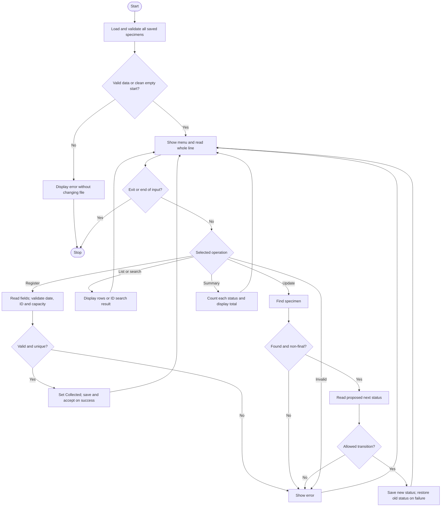

# Algorithm — Laboratory Specimen Tracker

## Main algorithm

1. Start and load all saved specimens with field, date, status, duplicate and capacity validation.
2. If there is no data and no recovery backup, start empty. On unreadable/invalid data or a required backup recovery, stop without changing files.
3. Display the menu and read a whole line.
4. On end-of-input, cancel any incomplete operation and stop.
5. Perform the selected operation:
   - **Register:** check capacity; read a unique ID, fictitious patient code, sample type and valid collection date; set status to Collected; save; increase count only if saving succeeds.
   - **List:** display saved records or a no-records message.
   - **Search:** perform linear search by specimen ID and display full details or not-found.
   - **Update:** find the record; if final, refuse changes; otherwise read an exact status option and check it against the transition rules; save the new status or restore the previous in-memory status if saving fails.
   - **Summary:** initialise four counters to zero, scan the records, increment the corresponding status counter, and display totals.
   - **Exit:** stop.
6. Show an error for invalid input/choice and return to the menu.
7. Repeat until Exit or end-of-input.

## Transition subroutine

- Collected accepts InProcess or Rejected.
- InProcess accepts Completed or Rejected.
- Completed and Rejected have no outgoing transition.
- Refuse all other updates without saving.

These are explicitly simplified coursework rules, not a clinical protocol.

## Save subroutine

Write and check a temporary file, close it successfully, preserve the old main as `.bak`, and install the new file. Attempt to restore the backup if installation fails. The calling function accepts the new in-memory status only on success. Standard C rename steps do not guarantee power-failure-safe or multi-user storage.

## Flowchart

End-of-input during any prompt exits cleanly without accepting an incomplete operation.
